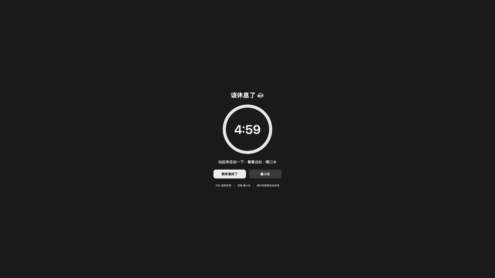
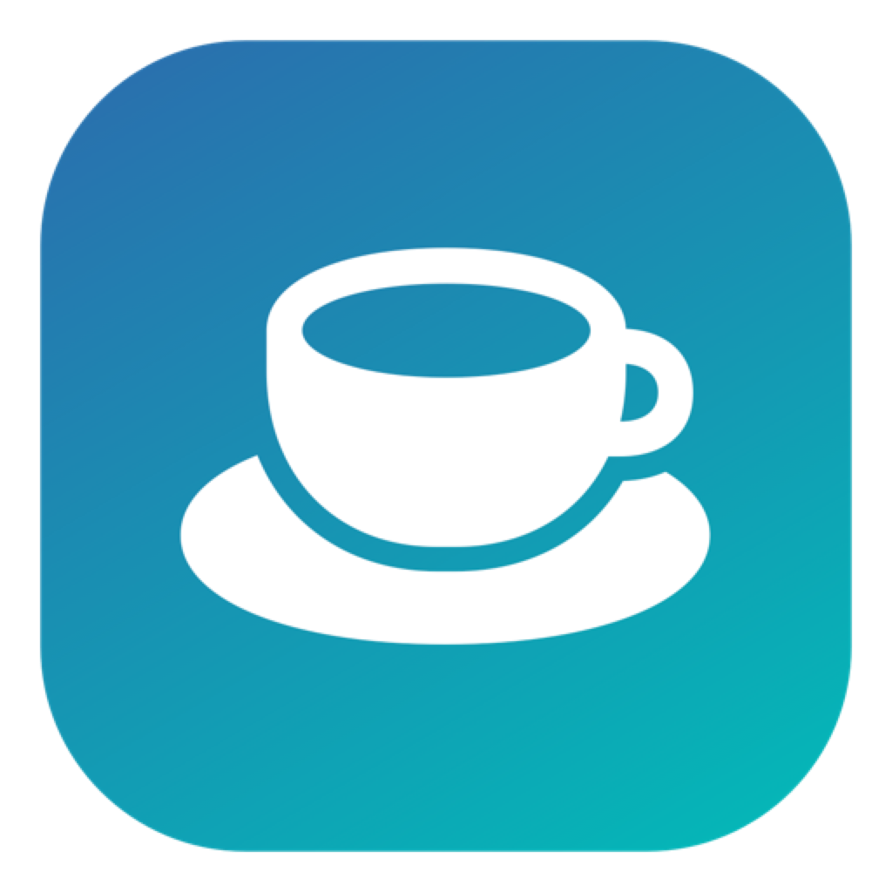

# RestReminder · 休息提醒

A macOS menu bar app that makes you actually take a break: after every hour of work it covers **all your screens** with a 5-minute countdown, then gets out of the way.

一个 macOS 菜单栏小工具：工作满一小时，用全屏遮盖 + 倒计时「叮嘱」你休息 5 分钟。可以一键结束，也可以最小化到角落继续倒计时。

[中文说明 →](README.zh-CN.md)



<p>


</p>

Native Swift + AppKit, ~900 lines, **no dependencies, no network, no data collection** — and it doesn't ask for a single system permission.

## Features

- **Work / break cycle** — 60 min work → 5 min break by default, both configurable from the menu (15/25/30/45/50/60/90/120 min work, 3/5/10/15 min break). Time left until the next break is always visible in the menu bar.
- **Full-screen overlay on every display** — one borderless window per screen at screen-saver level: the main screen shows the big countdown ring and the buttons, secondary screens show a slim countdown.
- **A countdown that ends itself** — when the 5 minutes are up the overlay closes and the next work cycle starts on its own. Display sleep is blocked while you're resting, so the overlay can't be missed.
- **Close it early** — click *I'm refreshed*, or press `ESC` / `Return`.
- **Minimize it** — click *Minimize* or press `Space`: the overlay collapses into a small draggable pill in the bottom-right corner (`☕️ Break 4:32`) that keeps counting down and brings the full overlay back when clicked. It's a non-activating panel, so it never steals keyboard focus while you keep typing.
- **Reminders** — system sound, optional spoken reminder (via `say`), plus a notification.
- **Launch at login** — one checkbox in the menu (it writes its own LaunchAgent).

## Install

### Option A — download the app

Grab `RestReminder-1.0.0-macos-universal.dmg` (or `.zip`) from the [Releases](../../releases) page, drag the app into `Applications`, and open it.

> **First launch may be blocked by Gatekeeper.** This app is ad-hoc signed and **not notarized** (notarization requires a paid Apple Developer account), so macOS may claim it "cannot be verified" or "is damaged". Fix it once with either:
> - Right-click the app → **Open** → **Open**, or
> - `xattr -dr com.apple.quarantine /Applications/RestReminder.app`
>
> Everything runs locally; nothing is downloaded or phoned home.

### Option B — build from source

Requires only the macOS Command Line Tools (`xcode-select --install`), **not** full Xcode.

```bash
git clone <this repo>
cd RestReminder
./build.sh          # build for your architecture, sign, install into ~/Applications
./build.sh run      # ...and launch it
```

Universal build plus dmg + zip (what the releases ship):

```bash
./build.sh release  # dist/RestReminder-1.0.0-macos-universal.{dmg,zip}
```

## Usage

After launch there's **no Dock icon** — look for the ☕️ in the menu bar, showing the time until your next break.

| Action | How |
|---|---|
| Finish the break early | *I'm refreshed* button, `ESC` or `Return` |
| Minimize the overlay | *Minimize* button or `Space` |
| Bring the overlay back | click the ☕️ pill in the bottom-right corner |
| Take a break right now | menu → *Take a break now* |
| Pause / resume the timer | menu → *Pause timer* |
| Change the intervals | menu → *Work interval* / *Break length* |
| Cover only the current screen | menu → uncheck *Cover all screens* |
| Start with the Mac | menu → *Launch at login* |

Settings live in `~/Library/Preferences/com.restreminder.app.plist`. The UI follows your system language (Chinese or English).

## Debugging & self-test

The app can drive its own UI, so you don't have to wait an hour to test it:

```bash
BIN=~/Applications/RestReminder.app/Contents/MacOS/RestReminder

# walk the whole flow (overlay → minimize → restore → finish) printing diagnostics, exit 0
"$BIN" -selftest 1

# run a real 6s work / 12s break cycle (arguments override settings, nothing is persisted)
"$BIN" -workMinutes 0.1 -breakMinutes 0.2

# render the overlay / the minimized pill to PNG — no screen-recording permission needed
"$BIN" -snapshot /tmp/cover.png
"$BIN" -snapshot /tmp/mini.png -snapshotMini 1
```

## How it works

- The overlay is a borderless `NSWindow` at `CGWindowLevelForKey(.screenSaverWindow)` with `.canJoinAllSpaces`, so it covers full-screen apps, all Spaces and every display. It overrides `canBecomeKey` back to `true` — a borderless window can't receive `ESC` / `Space` otherwise.
- The minimized pill is an `NSPanel` with `.nonactivatingPanel`, so showing and updating it never takes keyboard focus.
- Timing is derived from a `deadline` timestamp rather than accumulated ticks, so closing the lid or sleeping doesn't drift the schedule.
- `-snapshot` renders the view tree to a bitmap with `cacheDisplay(in:to:)` instead of taking a screen capture, which keeps the feature permission-free.

## Project layout

```
Sources/main.swift        everything: menu bar, timer state machine, overlay, pill, launch-at-login
scripts/gen-icon.swift    renders the app icon (SF Symbol → iconset → icns)
build.sh                  build / release (universal + dmg + zip) / run
docs/                     screenshots used by the READMEs
```

## License

[MIT](LICENSE) © 2026 Huage
